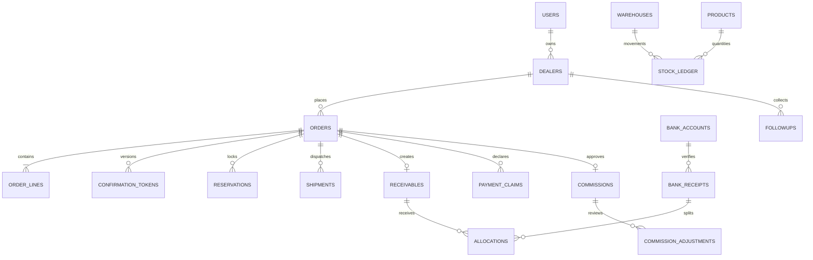

2026-11-01 最新政策补充：销售在其他类型可单选管理员发布且有效的政策（标准价、买10送1、Demo八折）。标准价/政策价合规的其他订单直接生效供仓库发货；价格例外逐单管理员审核。现付仍由财务核实足额到账，寄售保持管理员审核。Demo按经销商+车型一次，生效占用，整单撤销释放；政策换月不重置名额。管理员可编辑名称/说明/有效期、发布草稿或停用，销售端每30秒更新；历史订单保留价格及政策名称。详见 SALES_POLICIES.md。下文冲突的早期规定由此替代。

2026-10-31 最新销售流程：销售可建现付/寄售/其他并自定单价。admin_review_pending 持久化管理员审批门槛：销售自定价现付先管理员批准再财务核实足额到账；销售寄售/其他仅管理员审核生效。财务不可审批非现付，不能越过待批准价格。期初/历史订单迁移默认不新增审批门槛；版本4只增加字段，保留账本与历史状态。

# HYNAK MVP 架构、状态机和里程碑

## 架构与实体关系
FastAPI + SQLAlchemy + Jinja2/原生 JS 单体。SQLite 本地单进程；PostgreSQL 云端单实例。无前端构建依赖。金额整数分，比例整数基点；最终佣金 Decimal HALF_UP。

users → dealers（主账号/责任销售）；dealers → orders → order_lines。
orders → confirmation_tokens（版本、哈希、到期、动作）/ reservations / shipments。
warehouses → stock_ledger（不可更新/删除）；库存=sum(delta)，可用=余额-有效锁货。
orders → receivables → allocations ← bank_receipts → bank_accounts。
payment_claims → 私有附件；不参与实收汇总。预存款=期初信用+银行实收-分配。
warehouses（寄售类型、dealer_id）→ consignment_reports → 已确认销售订单。
orders → commission_records；dealers → collection_followups。
import_batches → 已核实行/待核实行；所有关键写操作 → audit_logs。

每个写请求一个事务。SQLite BEGIN IMMEDIATE，PostgreSQL 事务级 advisory lock，串行化业务写以保证 MVP 数量/金额并发正确。数据库唯一约束负责 token、银行参考号、批次及幂等键；不以页面按钮代替权限校验。每次查询限制经销商/销售对象归属。银行账户和库存地点对经销商不公开。

## 现付订单财务生效流程（2026-10-31）

经销商/销售提交现付订单及付款时间、水单 → WAITING_FINANCE_REVIEW → 财务核实并关联足额银行到账 → 同一事务创建应收、分配款项、CONFIRMED、锁定可用库存。银行收款必须由finance角色核实；价格审核、客户确认链接、未关联订单的收款不能替代财务生效。部分到账不生效；允许追加不同银行交易，超额保留预存款；银行账号+参考号与分配幂等键防重复。生效时间就是财务足额核实通过时间。

## 寄售及历史普通批发路径与报价快照
自助：WAITING_INTERNAL_REVIEW → 管理员审核 → CONFIRMED（创建应收及有货部分72小时锁货）。
代拟：DRAFT → WAITING_INTERNAL_REVIEW → 管理员批准价格/到期日/销售归属 → WAITING_DEALER_CONFIRMATION → 明示确认 → CONFIRMED；拒绝 → REJECTED；过期 → EXPIRED。
审核锁定 order_lines 单价、赠品、总额、付款条件和版本。生成链接只返回一次明文 token（secrets.token_urlsafe(32)），数据库保存 SHA256；默认7天。变更前撤销 token、版本+1、重新审核。终态 token 不重复生效；报价公开页只返回必要快照。生效后不允许直接改价，管理员通过有原因的调整流水冲销。

库存出库与实际交付分离。未提货出库撤销回补；已交付须登记实际退回。70/30赠品全额收到前禁止出库。佣金仅全部车辆（含赠品）交付、应收全额分配、主管审核后可结算。

## 四个里程碑与演示
1. 基础+订单：首登设管理员→建销售/经销商→自助订单审核；销售代拟→报价审核→同机手机宽度确认页。
2. 库存+应收：期初入库→调拨→出库→交付；寄售发出→上报3台→确认一次→应收。
3. 财务+运营：截图不增实收→银行核实→跨订单分配→欠款跟进/WhatsApp草稿→佣金审核结算；六类XLSX期初导入、预览、幂等及导出。
4. 验收：隔离数据库自动测试、权限/事务/重试、备份恢复、Mac运行；Windows及外网HTTPS需目标环境实测。

## 关键风险与处理
- 真实期初数据、佣金比例、收款账户、切换日尚未提供：不伪造；管理员录入/确认后生效。
- 本地确认链接不能用于异地经销商。云端设置 HTTPS PUBLIC_BASE_URL、安全cookie、私有持久卷和每日异地备份；真实云主机/域名另行配置。
- SQLite仅用于本地单进程。生产 PostgreSQL；数据库 schema 同源，升级脚本有版本号；跨数据库数据迁移属后续人工部署步骤。
- 首次需要Python 3.11+与网络安装依赖；双击脚本自动建venv，不制作原生安装器。
- 银行核实是人工职责；唯一银行账号+交易号防重复，截图不能替代。
- 本版只做PRD P0，不含完整ERP、历史9表逐行重建或自动WhatsApp消息发送。

## 核心ER关系

